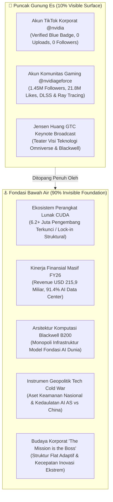
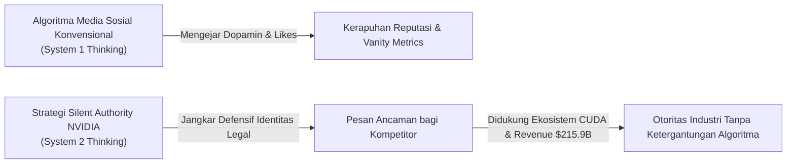

# NVIDIA: Silent Authority & Paradigma Branding Iceberg

[](https://www.python.org/)
[](https://streamlit.io/)
[](https://ipssj.com)
[](https://ipssj.com)
[](tests/)
[](LICENSE)

> **Repositori Resmi Riset Ilmiah & Laboratorium Analisis Interaktif**  
> Didasarkan pada publikasi:  
> *“Silent Authority dan Paradigma Branding Iceberg: Analisis Strategi Komunikasi Digital NVIDIA di Platform TikTok dalam Era Marketing 5.0”*  
> Diterbitkan pada: **Integrative Perspectives of Social and Science Journal (IPSSJ)**, Volume 3 Nomor 9, 2026.

---

## 📌 Penulis & Afiliasi Akademik

1. **Indri Anjar Kartika Sari** (*Corresponding Author*)  
   *Magister Ilmu Komunikasi, Universitas Pembangunan Nasional "Veteran" Jawa Timur, Surabaya, Indonesia*  
   📧 Kontak: `indri.cs2026@ids.ac.id` | `indri.kartikasari007@gmail.com`
2. **Agung Budi Prasetio**  
   *Institut Teknologi Tangerang Selatan, Tangerang Selatan, Indonesia*  
   📧 Kontak: `agung@itts.ac.id`
3. **Waspodo Tjipto Subroto**  
   *Fakultas Ekonomika dan Bisnis, Universitas Negeri Surabaya, Surabaya, Indonesia*  
   📧 Kontak: `waspodosubroto@unesa.ac.id`

---

## 📖 Abstrak / Abstract

### Bahasa Indonesia
Penelitian ini menganalisis kehadiran digital akun TikTok resmi NVIDIA (`@nvidia`) menggunakan kerangka **Branding Iceberg** dan konsep **Silent Authority**. Penelitian menggunakan desain studi kasus kualitatif dengan observasi digital nonpartisipatif dan analisis dokumen. Unit analisis meliputi status verifikasi akun, aktivitas konten, indikator audiens yang terlihat, arsitektur akun, serta dokumen korporasi dan teknologi yang relevan.

Analisis dilakukan melalui pengodean tematik ke dalam dua lapisan: *visible elements* (10%) dan *invisible foundations* (90%). Triangulasi sumber digunakan dengan membandingkan observasi platform, dokumen resmi NVIDIA, dan literatur akademik. Hasil menunjukkan bahwa minimnya aktivitas pada akun korporat tidak dapat serta-merta dinilai sebagai kelalaian, melainkan bentuk konfigurasi identitas digital terencana (*defensive registration*). Hegemoni ekosistem CUDA, performa finansial masif (Pendapatan FY26 sebesar **USD 215,9 Miliar**), dan struktur komunikasi terpisah membuktikan kemenangan substansi industri atas perlombaan viralitas video pendek dalam lanskap Marketing 5.0.

### English
This study investigates the digital presence of NVIDIA’s official TikTok account (`@nvidia`) through the dual frameworks of the **Branding Iceberg** and the concept of **Silent Authority**. Employing a qualitative case study design with non-participatory digital observation and document analysis, the inquiry evaluates account verification status, content activity, audience metrics, brand architecture, and corporate developer literature.

Thematic coding reveals a structural duality between visible surface elements (10%) and subsurface foundations (90%). By triangulating live platform observation with public corporate disclosures and academic literature, the study demonstrates that zero-upload corporate activity represents a calculated defensive registration posture rather than strategic negligence. Bolstered by the 20-year CUDA ecosystem lock-in, historic financial dominance (**USD 215.9 Billion revenue in FY26**), and Jensen Huang’s GTC keynote theater, NVIDIA exemplifies how industrial hegemony renders short-form algorithmic vanity metrics irrelevant in Marketing 5.0.

---

## 🧊 Kerangka Konseptual (Conceptual Framework)

### 1. Matriks Branding Iceberg


---

### 2. Paradigma Silent Authority (System 1 vs System 2 Thinking)


---

## 📊 Gap Analysis: Ekspektasi Publik vs Realitas Strategis (Tabel 2 Makalah)

| Dimensi | Ekspektasi Publik (10% Permukaan) | Realitas Strategis NVIDIA (90% Fondasi) | Dampak Strategis |
| :--- | :--- | :--- | :--- |
| **Kehadiran Digital** | Konten aktif, tren viral, dan posting harian di akun korporat utama. | *Defensive Registration* & perlindungan identitas siber terverifikasi. | *Silent Authority* & aura eksklusivitas korporat kelas atas. |
| **Metrik Keberhasilan** | Followers jutaan, jumlah *likes* melimpah, dan *engagement rate* tinggi. | Revenue FY26 **USD 215,9 Miliar**, 91% pendapatan Data Center, dominasi pasar AI. | *Vanity metrics* sosial terbukti tak berkorelasi vs performa finansial riil. |
| **Arsitektur Teknologi** | Produk visual yang "keren", estetis, dan instan untuk konsumsi umum. | Fondasi ekosistem CUDA 20 tahun + arsitektur chip Blackwell B200. | *Ecosystem Lock-in* struktural (*economic moat*) sulit ditembus kompetitor. |
| **Geopolitik** | Netralitas komersial korporasi murni dalam perdagangan bebas global. | Instrumen strategis *Tech Cold War* antara AS vs China dan kedaulatan AI. | *Brand* bertransformasi dari sekadar vendor perangkat keras menjadi aset pertahanan negara. |
| **Budaya Organisasi** | Hierarki birokrasi korporat kaku dengan pembagian divisi tradisional. | Filosofi *"The mission is the boss"*, struktur adaptif, kepemimpinan Jensen Huang. | Kecepatan eksekusi dan inovasi radikal melampaui siklus kompetitor. |

---

## 🛡️ Protokol Mitigasi Krisis Komunikasi RHWR

Untuk menutup *Interpretation Gap* dan mencegah sentimen negatif akibat keheningan publik, makalah merumuskan filter **RHWR** (*Rational, Healthy, Wise, Right*):

```
       [R] Rational  --> Berbasis bukti empiris, data telemetri laboratorium, dan validitas matematis.
       [H] Healthy   --> Menjaga keberlangsungan mutualisme pengembang ekosistem dan mitra OEM.
       [W] Wise      --> Peka terhadap ketegangan geopolitik (Tech Cold War) dan dinamika blok regional.
       [R] Right     --> Patuh pada standar etika kecerdasan buatan dan regulasi perdagangan internasional.
```

---

## 🚀 Menjalankan Laboratorium Interaktif (Streamlit Dashboard)

Repositori ini dilengkapi aplikasi web analitik interaktif berbasis **Streamlit**:

### 1. Persyaratan Sistem
- Python 3.10 atau versi lebih baru
- Virtual environment (direkomendasikan)

### 2. Instalasi Dependensi
```bash
git clone https://github.com/indri007/NVIDIA.git
cd NVIDIA
pip install -r requirements.txt
```

### 3. Menjalankan Dashboard
```bash
streamlit run app.py
```
Aplikasi akan aktif secara lokal di: `http://localhost:8501` (atau port yang dialokasikan).

### 4. Menjalankan Uji Otomatis (Test Suite)
```bash
pytest tests/ -v
```

### 5. Menjalankan Diagnostik CLI Observasi Digital
```bash
python scripts/digital_observation.py
```

---

## 📂 Struktur Repositori

```text
NVIDIA/
├── README.md                      # Dokumentasi komprehensif dwibahasa (ID/EN)
├── app.py                         # Streamlit Interactive Analytics Dashboard
├── requirements.txt               # Dependensi paket Python
├── .gitignore                     # Proteksi kredensial dan cache
├── data/
│   ├── tiktok_observation.json    # Data observasi empiris akun TikTok & Keynote
│   ├── financial_vs_social.csv    # Time-series finansial (FY21-FY26) vs aktivitas TikTok
│   ├── gap_analysis.json          # 5 dimensi Gap Analysis (Tabel 2 Makalah)
│   ├── iceberg_dimensions.json    # Taksonomi bobot 10% Visible vs 90% Invisible
│   └── rhwr_framework.json        # Protokol filter krisis komunikasi RHWR
├── scripts/
│   ├── __init__.py
│   └── digital_observation.py     # Engine kalkulasi Silent Authority Index & evaluasi RHWR
├── tests/
│   ├── __init__.py
│   └── test_nvidia_app.py         # Test suite pytest (8 unit tests)
└── View of Silent Authority...pdf # Naskah lengkap jurnal ilmiah IPSSJ Vol. 3 No. 9 2026
```

---

## 📚 Sitasi Ilmiah (Citations)

### Format APA (7th Edition)
```text
Sari, I. A. K., Prasetio, A. B., & Subroto, W. T. (2026). Silent Authority dan Paradigma Branding Iceberg: Analisis Strategi Komunikasi Digital NVIDIA di Platform TikTok dalam Era Marketing 5.0. Integrative Perspectives of Social and Science Journal (IPSSJ), 3(9), 1-12.
```

### Format BibTeX
```bibtex
@article{sari2026silent,
  author    = {Sari, Indri Anjar Kartika and Prasetio, Agung Budi and Subroto, Waspodo Tjipto},
  title     = {Silent Authority dan Paradigma Branding Iceberg: Analisis Strategi Komunikasi Digital NVIDIA di Platform TikTok dalam Era Marketing 5.0},
  journal   = {Integrative Perspectives of Social and Science Journal (IPSSJ)},
  volume    = {3},
  number    = {9},
  pages     = {1--12},
  year      = {2026},
  issn      = {3064-4011}
}
```

---

## 📄 Lisensi & Hak Cipta
Hak Cipta © 2026 **Indri Anjar Kartika Sari, Agung Budi Prasetio, Waspodo Tjipto Subroto**.  
Dirilis di bawah lisensi terbuka [MIT License](LICENSE).